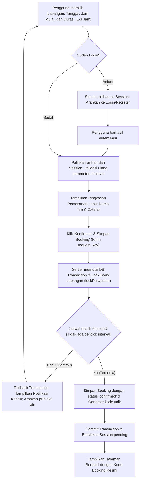
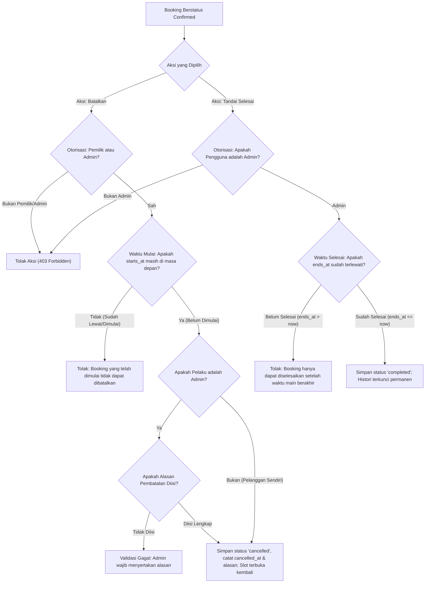
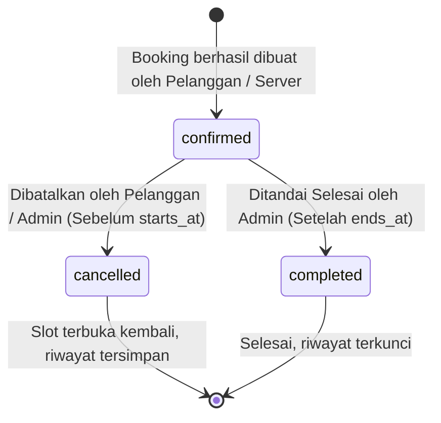

# Diagram Alur & Flowchart — FutsalKita

Dokumen ini memuat diagram alur interaksi dan logika transisi sistem FutsalKita menggunakan sintaks Mermaid standar.

---

## 1. Alur Pemesanan Jadwal (Booking Flow)

---

## 2. Alur Pembatalan & Penyelesaian Booking

---

## 3. Diagram State Status Booking

